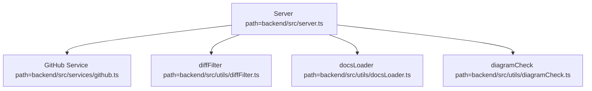

# Aider

**Mỗi node trong sơ đồ kiến trúc của bạn phải ánh xạ tới một file có thật. Aider chỉ ra chính xác node nào đang nói dối.**

Aider giữ cho sơ đồ kiến trúc trong `README.md` không trôi khỏi code — nhưng không bằng cách để một mô hình ngôn ngữ tự sửa sơ đồ. Phần kiểm chứng chạy hoàn toàn tất định: nó đọc file tree thật từ `git ls-files`, đối chiếu từng node trong sơ đồ Mermaid, và báo node nào không tương ứng với file nào. Không có mạng, không có API key, không có ảo giác.

<!-- AIDER:START -->

<!-- AIDER:END -->

## Cách cài

```bash
cd cli
npm install
npm run build
```

## Cách dùng

```bash
# Kiểm chứng sơ đồ trong README.md (chạy được offline, không cần LLM)
node cli/dist/index.js verify

# Kiểm chứng một repo khác
node cli/dist/index.js verify --path /đường/dẫn/repo

# Máy đọc
node cli/dist/index.js verify --json

# Đề xuất cập nhật sơ đồ (cần AIDER_LLM_API_KEY)
node cli/dist/index.js propose --dry-run
node cli/dist/index.js propose --write

# Cài git hook tự động sinh commit message
node cli/dist/index.js init
```

`verify` trả exit code `1` khi có node không ánh xạ tới file nào — cắm thẳng vào CI (xem `.github/workflows/aider-verify.yml`).

### Cấu hình LLM

`propose` gọi một API tương thích OpenAI (`POST /chat/completions`). Không cần SDK, chỉ cần ba biến môi trường:

| Biến | Mặc định | Ý nghĩa |
|---|---|---|
| `AIDER_LLM_API_KEY` | *(bắt buộc)* | Khoá gọi mô hình. Thiếu nó, `propose` thoát code `2` và `verify` không bị ảnh hưởng. |
| `AIDER_LLM_BASE_URL` | `http://127.0.0.1:8317/v1` | Endpoint. Đổi sang nhà cung cấp khác nếu cần. |
| `AIDER_LLM_MODEL` | `glm-flash` | Tên model gửi trong request. |

## Tự động bình luận lên Pull Request

Không cần máy chủ. Job `review` trong `.github/workflows/aider-verify.yml` chạy bộ kiểm chứng trên mỗi PR và đăng kết quả thành bình luận, cập nhật bình luận cũ thay vì thêm mới. Vì Actions có toàn bộ mã nguồn sau khi checkout, nó kiểm tra được cả **cạnh lệch** — điều một webhook chỉ có danh sách tên file không làm được.

`verify --markdown` sinh nội dung bình luận:

```bash
node cli/dist/index.js verify --markdown > report.md
```

### Bước AI trên PR (tùy chọn)

Job `review` có thêm một bước gọi `propose` và nối đề xuất của mô hình vào cuối bình luận. Nó chỉ chạy khi repo có:

| Loại | Tên | Giá trị |
|---|---|---|
| Variable | `AIDER_AI_REVIEW` | `on` để bật |
| Secret | `AIDER_LLM_API_KEY` | khoá gọi mô hình |
| Variable | `AIDER_LLM_BASE_URL` | ví dụ `https://api-cdn.deploy.com/api/v1` |
| Variable | `AIDER_LLM_MODEL` | ví dụ `zai-org/glm-5.3-flash` |

Bước này **không bao giờ làm đỏ CI**. `propose` chỉ đề xuất trên nền sơ đồ đang đúng, và tự loại mọi node không kèm đường dẫn file có thật — nên mô hình sai thì kết quả tệ nhất là không có đề xuất, không phải sơ đồ bịa. Thiếu khoá hoặc endpoint lỗi thì bình luận ghi rõ lý do.

Hai điều cần biết trước khi bật:

- **PR mở từ fork không nhận được secret.** Bước AI tự bỏ qua ở đó; phần kiểm chứng tất định vẫn chạy.
- **Variables là công khai.** Chỉ `AIDER_LLM_API_KEY` nằm trong Secrets; đừng bao giờ đặt khoá vào Variables.

## Backend (tùy chọn, không cần cho CI)

Có một service Express nhận webhook GitHub, dùng khi bạn muốn phản hồi tức thì thay vì chờ Actions, hoặc dùng ngoài GitHub:

```bash
cd backend
npm install
npm run build
AIDER_LLM_API_KEY=... GITHUB_TOKEN=... WEBHOOK_SECRET=... npm start
```

Cùng ba biến `AIDER_LLM_*` như trên. `POST /api/commit` còn nhận khoá theo từng request qua header `x-llm-api-key`, để client không phải chia sẻ khoá với server.

Xem `docs/self_hosting_guide.md` để triển khai bằng Docker. Lưu ý: build context là thư mục gốc `Aider/`, không phải `backend/`.

`WEBHOOK_SECRET` là bắt buộc — thiếu nó server từ chối khởi động, vì route webhook không được phép chạy mà không xác thực chữ ký.

## Giới hạn

Ánh xạ node → file dựa trên tên file, không dùng embedding hay LLM. Với repo có tên file khác xa khái niệm kiến trúc (ví dụ node `Auth Service` nhưng file tên `middleware.ts`), node đó sẽ bị báo `UNMAPPED`. Ghi `path` tường minh trong node để chỉ định chính xác.

## License

MIT
